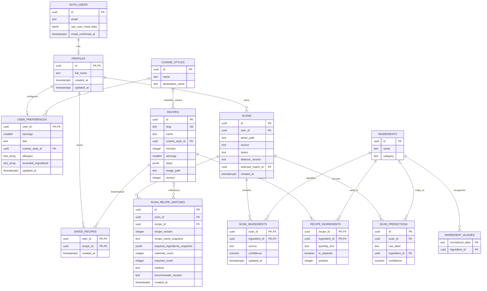

# Timpla database design

Design date: 22 October 2026. **Phase 1 is now applied:** profiles, preferences,
cuisine styles, ingredients, aliases, recipes and recipe ingredients. Scans,
recommendation history, cloud bookmarks and hunts remain proposed. See
[implementation status](database.md) and the saved migration for the exact live schema.

## What exists today

The current code uses Supabase Auth, which manages `auth.users` and the related authentication tables. Registration supplies the `full_name` key inside `raw_user_meta_data`. The new-account trigger copies it into `public.profiles.full_name`, which is now the app's canonical name field.

Relevant existing account columns include `id` (UUID), `email`, `encrypted_password` (Supabase-managed password hash), `email_confirmed_at`, `raw_user_meta_data` (JSON), `created_at`, and `updated_at`. This is a relevant subset, not an inventory of every managed Auth column. Never create a second password column or modify the managed Auth schema for application preferences.

The phase-1 migration is saved at `supabase/migrations/202610220001_profiles_and_catalog.sql` and was applied through the dashboard SQL editor. The initial empty public schema, successful migration, and account access policies were verified live.

Current application data:

| Data | Current location | Proposed location |
| --- | --- | --- |
| Account and confirmation state | Supabase Auth | Supabase Auth |
| Full name | `profiles.full_name` | Implemented |
| Cooking style | `user_preferences` | Implemented; one-time local style import |
| Saved recipe IDs | Account-scoped local storage | `saved_recipes` |
| Servings, diet, allergies, exclusions | `user_preferences` | Implemented |
| Scan history and ingredient edits | App memory | `scans`, `scan_predictions`, `scan_ingredients` |
| Recipe catalog and instructions | Database for signed-in users; bundled data for preview | Implemented |
| Regional cooking options | `cuisine_styles` for signed-in users | Implemented |
| Reverse cooking checklist | App memory | Optional `ingredient_hunts`, `hunt_items` |
| Email logo | Public branding Storage bucket | Existing branding bucket |

## Relationships

`AUTH_USERS` below represents managed `auth.users`. `PROFILES`, `USER_PREFERENCES`, `CUISINE_STYLES`, `INGREDIENTS`, `INGREDIENT_ALIASES`, `RECIPES` and `RECIPE_INGREDIENTS` are implemented. The other entities are future design. `PK` means primary key; `FK` means foreign key. Child rows can be absent even when their parent exists.



The selected dish is `scans.selected_match_id`, pointing to one of that scan's `scan_recipe_matches` rows. The selected relationship is explained here rather than drawn as another crossing line. Enforce that the selected match belongs to the same scan with a composite foreign key `(id, selected_match_id)` referencing `(scan_id, id)` on the match table. Create the scan first with no selection. Add the circular selection constraint after both tables exist.

## Column rules and purpose

All timestamps use PostgreSQL `timestamptz`, stored as instants and displayed in the user's local time (Asia/Manila for the current audience). UUID primary keys use database-generated UUIDs. Proposed tables are in `public`; the existing account table stays in `auth`.

### Profiles and preferences

- `profiles.id` is both its primary key and a foreign key to `auth.users.id`, with `ON DELETE CASCADE`. One real account has at most one profile. `full_name` is required. Both timestamps default to the creation instant; updates maintain `updated_at`.
- `user_preferences.user_id` references `profiles.id`, with `ON DELETE CASCADE`. Defaults: `servings = 2`, `diet = 'No preference'`, empty allergy and exclusion arrays. Constrain servings to 1–20 and diet to the three supported values: `No preference`, `Vegetarian`, `Halal`.
- `cuisine_style_id` is nullable: null means **Any style**. It references `cuisine_styles.id`; deleting a style sets it to null.
- `allergies` and `excluded_ingredients` use PostgreSQL `text[]` for the initial app's simple multi-select settings. Trim and deduplicate values. These are preferences, not a verified allergen-safety database. Ingredient-level allergen mappings can be introduced separately if that capability is built.
- `cuisine_styles.name` is unique. Initial rows mirror the app: Bicolano/Bicol, Ilocano/Ilocos, Kapampangan/Pampanga, Ilonggo/Iloilo. These are cuisine groupings, not Philippine administrative regions. A recipe's optional style describes that particular variant; it does not assert exclusive historical origin.
- During implementation, backfill profile names from `raw_user_meta_data.full_name`, then update profile reads/writes together. Make `profiles.full_name` the app's canonical name after that switch; avoid two independently editable copies.

### Ingredients and recipe catalog

- `ingredients.name` is unique after normalization. `category` can cover fruit, vegetable, meat, seafood, seasoning, and other supported ingredients.
- `ingredient_aliases.normalized_alias` is a globally unique normalized spelling such as `talong` or `eggplant`, mapping to a single canonical ingredient. Do not collapse different ingredients into one alias. Canonical names must participate in the same collision checks as aliases.
- `recipes.slug` preserves current stable identifiers such as `tortang-talong`; UUID `id` becomes the database key. `name`, positive `minutes`, positive `servings`, ordered `steps`, and positive `version` are required. `steps` is an ordered JSON array of strings; `image_path` is optional. Add `published boolean default false`, `source_url text`, `license text`, `created_at`, and `updated_at` when creating the catalog tables.
- `recipe_ingredients` has a composite primary key `(recipe_id, ingredient_id)`: an ingredient counts once per recipe. `quantity_text` preserves existing phrases such as `Salt, to taste`; it does not promise automatic quantity scaling. `position` preserves display order. `is_required` defaults to true. Deleting a recipe cascades its join rows; referenced ingredients should be archived instead of deleted.
- A published recipe must have at least one required ingredient. Enforce this at the publish operation, since a row-level check cannot validate child rows. Changing requirements increments the recipe version.

### Scans and detection results

- `scans.user_id` references the owner profile with `ON DELETE CASCADE`. `source` is `camera` or `upload`; `status` is `pending`, `completed`, or `failed`. `photo_path` holds a private Storage object path, not a local `file://` URI or an expiring signed URL. Retain capture time even when detection fails.
- `detector_version` records the model/checkpoint identifier used for that scan, enabling later comparisons with Timpla-trained YOLOv8 models. Store no model binary in this table.
- `scan_predictions` preserves the original model output separately from user corrections. `raw_label` is required, `ingredient_id` may be null for an unmapped label, and `confidence` must be between 0 and 1. Its shape can initially match the API's current per-ingredient detections. If the API later exposes individual boxes, add bounding-box coordinates with their coordinate convention before storing them.
- `scan_ingredients` contains the current, deduplicated ingredient list used for recipe matching. Its composite key is `(scan_id, ingredient_id)`. `source` is `detected` or `manual`. Keep the highest confidence for duplicate detected ingredients. Manual additions/corrections have null confidence; never invent confidence for them. Removing an ingredient deletes its current-list row while leaving the original prediction intact.
- Retrying detection should replace the original output for the recorded attempt and update the model identifier consistently. If multiple attempts need to be retained later, add a `scan_attempts` parent rather than mixing outputs from different runs without provenance.
- `scan_predictions` and `scan_ingredients` cascade when a scan is deleted. Photo deletion is a separate Storage cleanup operation; deleting a database row alone does not remove its object.

### Recipe matches, selection, and saved recipes

- `scan_recipe_matches` stores the suggestions for a scan. `recipe_id` can be set to null if a catalog recipe is retired/deleted; snapshot name, version, and required ingredients preserve the meaning of the history entry. `required_ingredients_snapshot` stores canonical ingredient IDs plus display names, not only mutable names.
- `method` starts as `ingredient_overlap`. `recommender_version` identifies the matching implementation. Future learned dish suggestions can use a different method and a separate score field, with its meaning documented.
- Require `required_count > 0` and `0 <= matched_count <= required_count`. Match counts use unique required ingredients. Refresh the counts and selected match when a user changes their ingredient list; recipe-requirement snapshots stay fixed for that recommendation set. Recents therefore reflects the latest reviewed state, as the current app does.
- `saved_recipes` is a join table with composite primary key `(user_id, recipe_id)`, preventing duplicate bookmarks. Deleting a user or recipe cascades the corresponding bookmarks.
- User dish selection records a choice, not proof that the dish was cooked or that a model prediction was correct.

## Percentages

**Detection confidence** describes an individual model prediction, for example `0.88` displayed as **88% confidence**. It is not measured accuracy and should not be presented as a verified probability of correctness.

**Recipe ingredient match** is computed as:

```text
match_percent = round(100 * matched_count / required_count)
```

For example, four matching required ingredients out of six gives **67% match**. Optional ingredients are excluded from the denominator. A recipe with zero required ingredients cannot be published or matched. No separate editable percentage column is needed. Ingredients are compared by canonical ID after alias normalization.

For Recents, display ingredient confidences in the detail view. If a scan-level average is shown, label it **Average detection confidence**, exclude manual/null-confidence items, and leave it blank when there are no model predictions. Do not call that average accuracy. Model accuracy requires evaluation on a labeled test set.

## Optional reverse cooking tables

Add these when persisting the ingredient-hunting flow:

| Table | Columns | Relationships |
| --- | --- | --- |
| `ingredient_hunts` | `id uuid PK`, `user_id uuid FK`, `recipe_id uuid FK`, `status text`, `created_at timestamptz`, `updated_at timestamptz` | One user and recipe per hunt; status `active` or `completed`. |
| `hunt_items` | `hunt_id uuid PK/FK`, `ingredient_id uuid PK/FK`, `checked boolean`, `updated_at timestamptz` | One ingredient checklist row per hunt; delete rows with the hunt. |

The backend must ensure each hunt item belongs to the chosen recipe. User-owned hunts cascade on account deletion. Decide explicitly whether recipe edits migrate an active checklist or keep a versioned requirement snapshot before implementing this feature.

## Access and file storage

- Enable Row Level Security before exposing proposed tables through the app. Users read and write only their own profile, preferences, scans, bookmarks, and hunts. Child-table access must verify ownership through the parent scan or hunt for both existing and newly written rows.
- Only the inference backend writes original predictions, detector identifiers, match calculations, and protected scan-processing fields. The client may request processing, review ingredients, and select a same-scan suggestion through narrow, authorized operations. RLS alone does not restrict individual columns; use column grants or controlled functions for protected fields. The backend verifies the caller's Supabase access token and ownership. Secret/service-role keys never enter Expo.
- Authenticated users can read published recipes and their ingredient/style catalog. Catalog changes belong to controlled admin/backend operations. Decide guest browsing separately; the current development Skip mode creates no account and must not write cloud user data.
- Put scan images in a new **private** `scan-photos` bucket, with paths such as `<user-id>/<scan-id>/photo.jpg`. Restrict access to the owner, using authenticated reads or short-lived signed URLs. Keep the existing public `branding` bucket for the logo only.
- Enforce the image limit in both the upload path and server: positive file size no larger than **5,000,000 bytes (5 MB)**, decodable supported image formats, and validated content rather than extension alone. Agree on supported formats/conversion when implementing the upload endpoint.
- Index ownership and relationship lookups: `scans(user_id, created_at DESC)`, `scan_predictions(scan_id)`, `recipe_ingredients(ingredient_id)`, `scan_ingredients(ingredient_id)`, `recipes(cuisine_style_id)`, `scan_recipe_matches(scan_id, created_at DESC)`, `scan_recipe_matches(recipe_id)`, and `saved_recipes(recipe_id)`. Composite primary keys already support their leading-column lookups. Add the unique `(scan_id, id)` match key required by the selection constraint.
- Account deletion should first remove owned scan objects through a controlled server operation, then delete the Auth account so dependent application rows cascade. Plan retryable cleanup for partial failures; database cascades do not delete Storage files.

## Implementation order

1. Create profiles and preferences with ownership policies; migrate the name and current account-scoped settings deliberately.
2. Add ingredient/style/recipe catalog tables and import the current two starter recipes. This does not constitute a validated comprehensive Philippine recipe dataset.
3. Add scans, original predictions, reviewed ingredients, and private image storage; connect actual inference responses.
4. Add recipe-match history, dish selection, bookmarks, and optional hunts. Match ingredients with the catalog before adding a learned recommendation model.

No separate registration, login, email-confirmation, password-reset, SMTP credential, or OTP application table is needed. Supabase Auth manages those authentication flows; Brevo delivers their email.

## References

- [Supabase: managing user data](https://supabase.com/docs/guides/auth/managing-user-data) — link application profiles to the managed Auth primary key and protect exposed tables.
- [Supabase: Row Level Security](https://supabase.com/docs/guides/database/postgres/row-level-security) — restrict row access to the appropriate user.
- [Supabase: Storage access control](https://supabase.com/docs/guides/storage/security/access-control) — enforce file access with Storage policies.
